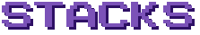

<!-- ===== TÍTULO (arquivo titulo.svg, pixel art em bold com sombra) ===== --> 
  
 <!-- ===== BANNER ANIMADO (arquivo banner.svg, na mesma pasta do README) ===== --> 
  
 <!-- ===== CONTATOS (botões roxo fosco brilhante: arquivos botao-linkedin.svg e botao-gmail.svg) ===== --> 
   

💻 Sobre mim
<!-- ===== TERMINAL ANIMADO ===== --> 
  

<!-- ===== TÍTULO STACKS (arquivo titulo-stacks.svg) ===== -->  <!-- ===== STACKS: cada ícone é um arquivo da pasta stacks/ ===== Para trocar para o cromado, troque "./stacks/" por "./stacks-cromado/". Para mudar a ordem, mova as linhas . Para remover, apague a linha. --> <h4 align="center">💻 Programação</h4> 
     
 <h4 align="center">🌐 Web</h4> 
   
 <h4 align="center">🗄️ Dados</h4> 
   
 <h4 align="center">🛠️ Ferramentas</h4> 
     
 <h4 align="center">📋 Metodologias e gestão</h4> 
    

<!-- ===== TÍTULO PROJECTS (arquivo titulo-projects.svg) ===== -->  <!-- Troque pelos seus projetos reais. Copie um bloco para adicionar mais. -->
Projeto	O que faz	Tecnologias
Nome do projeto	Explique em uma frase	C
Nome do projeto	Explique em uma frase	C++
Nome do projeto	Explique em uma frase	Python
📈 Minha atividade

  
 
  
 <!-- ===== COBRINHA ANIMADA (precisa do arquivo snake.yml) ===== --> 
 <picture> <source media="(prefers-color-scheme: dark)" srcset="https://raw.githubusercontent.com/gustavopalmentieri/gustavopalmentieri/output/github-snake-dark.svg"/> <source media="(prefers-color-scheme: light)" srcset="https://raw.githubusercontent.com/gustavopalmentieri/gustavopalmentieri/output/github-snake.svg"/>  </picture> 
 <!-- ===== RODAPÉ ANIMADO ===== --> 
